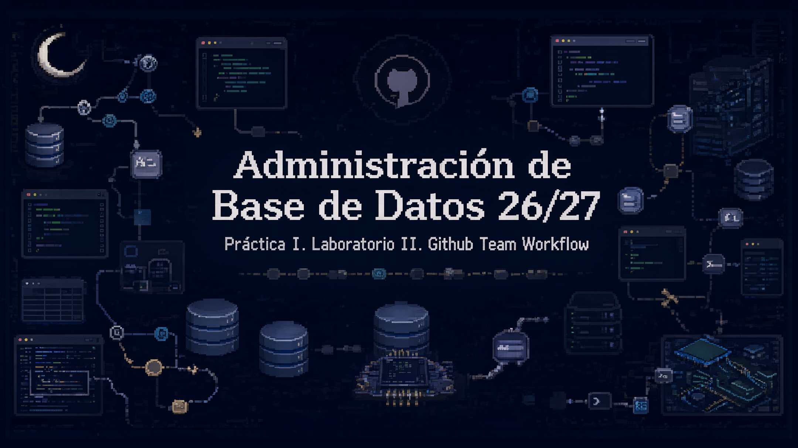

### Bases de Datos - Ingeniería Informática

**Curso académico 2026/2027 · Práctica I · Laboratorio II**

!\[Documentación](https://img.shields.io/badge/Documento-Preguntas\_de\_comprobaci%C3%B3n-17365D)
!\[GitHub](https://img.shields.io/badge/GitHub-Team\_Workflow-24292F?logo=github\&logoColor=white)
!\[Formato](https://img.shields.io/badge/Formato-Markdown-496E8A?logo=markdown\&logoColor=white)

*Issues · Branches · Commits · Pull Requests · Code Review*

## 

## Preguntas de comprobación

**1.¿Por qué un Issue sin criterios de aceptación es un problema, aunque la descripción general parezca clara?**

Leer respuesta

Un Issue puede describir una necesidad de forma comprensible y, aun así, dejar dudas sobre qué se considera terminado. La versión completa de la respuesta se halla en el PDF adjunto.

[↑ Volver al índice](#índice)

\---

**2. Explica la diferencia entre "Refs #N" y "Closes #N" en un mensaje de commit o en la descripción de un Pull Request.**

Leer respuesta

Refs #N es una referencia cruzada: relaciona el texto con el Issue N, pero no solicita cerrarlo. Closes #N emplea una palabra clave \[...]La versión completa de la respuesta se halla en el PDF adjunto.

[↑ Volver al índice](#índice)

\---

**3. ¿Qué ocurre exactamente si intentas hacer git push directamente sobre una branch main protegida? ¿Es un error tuyo o un fallo del sistema?**

Leer respuesta

Si main está protegida con una regla aplicable que obliga a pasar por un PR y quien hace push no tiene permiso de excepción, el servidor remoto rechaza la actualización. La versión completa de la respuesta se halla en el PDF adjunto.

[↑ Volver al índice](#índice)

\---

**4. Un compañero te dice: "he aprobado el PR sin mirar los archivos, total ya me fío". ¿Qué riesgo tiene esa forma de revisar?**

Leer respuesta

La confianza en la persona que propone el cambio no sustituye la revisión de su contenido. Aprobar sin abrir Files changed puede dejar pasar un error lógico \[...]La versión completa de la respuesta se halla en el PDF adjunto.

[↑ Volver al índice](#índice)

\---

**5. Si el reviewer pide un cambio y tú ya habías hecho push de tu branch, ¿tienes que abrir un Pull Request nuevo? Explica qué ocurre técnicamente con el PR existente cuando haces un nuevo commit.**

Leer respuesta

No se debe crear otro Pull Request si la corrección pertenece a la misma tarea. La versión completa de la respuesta se halla en el PDF adjunto.

[↑ Volver al índice](#índice)

\---

**6. Describe con tus palabras la diferencia entre Merge commit, Squash and merge y Rebase and merge. ¿Cuál usarías para una branch con commits "wip", "fix", "fix2", "ok ya"?**

Leer respuesta

Merge commit incorpora la rama conservando los commits originales y generando un commit de fusión que conecta las dos historias. La versión completa de la respuesta se halla en el PDF adjunto.

[↑ Volver al índice](#índice)

\---

**7. ¿Por qué borrar una branch después del merge no elimina el trabajo realizado en ella?**

Leer respuesta

Una rama es una referencia que señala un commit; eliminar su nombre no borra automáticamente las modificaciones que ya están integradas en otro lugar. La versión completa de la respuesta se halla en el PDF adjunto.

[↑ Volver al índice](#índice)

\---

**8. ¿Qué información debería contener siempre la descripción de un Pull Request, como mínimo?**

Leer respuesta abreviada

Como mínimo, un PR debe explicar qué pretende conseguir y por qué (Summary), qué archivos o comportamientos se han modificado (Changes), cómo se ha comprobado que funcionan (Testing) y qué Issue o tarea resuelve (Related Issue). La versión completa de la respuesta se halla en el PDF adjunto.

[↑ Volver al índice](#índice)

\---

**9. Un reviewer escribe solo "esto está mal" como comentario. ¿Qué le falta a ese comentario para ser útil? Reescríbelo tú con un ejemplo inventado.**

Leer respuesta abreviada

Comentar “esto está mal” no identifica el defecto, ni dónde se halla, ni cómo podría ser corregido. La versión completa de la respuesta se halla en el PDF adjunto.

[↑ Volver al índice](#índice)

\---

**10. ¿Qué diferencia hay entre que main esté protegida y que simplemente el equipo "se ponga de acuerdo" en no hacer push directo?**

Leer respuesta abreviada

El acuerdo verbal es una convención del equipo que depende de que todos la recuerden y respeten La versión completa de la respuesta se halla en el PDF adjunto.

[↑ Volver al índice](#índice)

\---

**11. Explica con un ejemplo propio la diferencia entre un comentario issue: (blocking) y uno nitpick: (if-minor) en formato Conventional Comments.**

Leer respuesta abreviada

issue: (blocking) expresa que existe un problema que debe resolverse antes de aceptar el cambio, mientras que nitpick: (if-minor) La versión completa de la respuesta se halla en el PDF adjunto.

[↑ Volver al índice](#índice)

\---

**12. Si tu próximo commit es feat!: cambia la firma de la función principal de la API, ¿qué tipo de versión SemVer se dispara y por qué?**

Leer respuesta abreviada

En Conventional Commits, el signo ! en feat! comunica que el commit introduce un breaking change, es decir, una modificación incompatible para quienes usan la interfaz anterior. La versión completa de la respuesta se halla en el PDF adjunto.

[↑ Volver al índice](#índice)

\---

**13. ¿Por qué abrir un Draft PR desde el primer commit estructural puede ahorrar tiempo al equipo, aunque parezca más lento para el autor individual?**

Leer respuesta abreviada

Un Draft Pull Request deja visible una propuesta que todavía no está lista para fusionarse. La versión completa de la respuesta se halla en el PDF adjunto.

[↑ Volver al índice](#índice)

*Laboratorio 2 · GitHub Team Workflow · Documentación académica*

